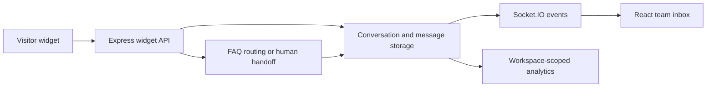

# Architecture and boundaries

The private prototype uses Node.js/Express, Socket.IO, Prisma/PostgreSQL and a React/TypeScript dashboard. Agent routes include authentication and workspace membership middleware. Public widget routes require their own session and access-control review; membership checks on the dashboard alone do not establish protection for every widget operation.

The selected helpers identify a possible email address and handoff phrases. The public router takes a local FAQ list, retaining the original priority order while removing database access and unverified reply claims. It returns the action label `email_captured` for parity with the private prototype; in this preview that label only means recognition, without storage or transmission.

The adapter's matching is intentionally simple. A substring such as “agent” may match inside another word, and keyword order can affect the result. Tests verify behavior boundaries; they do not establish language-model quality.

The full prototype has database-derived analytics and CRM configuration screens. Demo connection records must not be interpreted as functioning third-party OAuth or lead sync. Production identity, widget-session ownership, rate limits, consent, retention and monitoring need verification before handling real visitor information.
