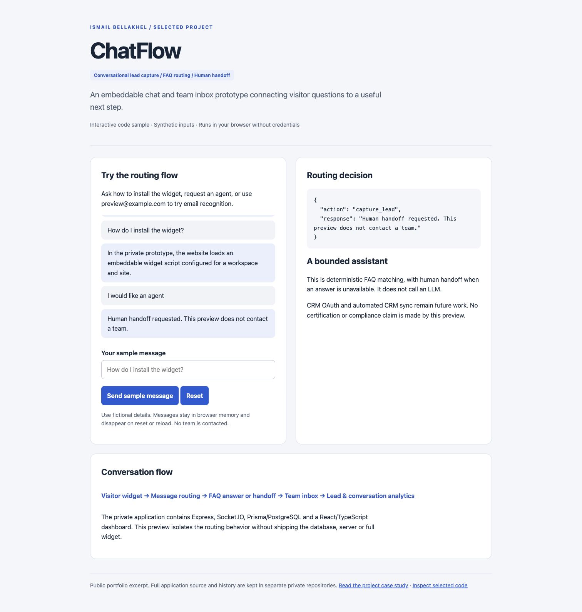

# ChatFlow — Conversational Lead Capture & Team Inbox

**[Open the interactive preview →](https://ismail-bellakhel.github.io/chatflow-showcase/)** · [](https://github.com/ismail-bellakhel/chatflow-showcase/actions/workflows/verify.yml)

**A B2B chat prototype connecting visitor questions, FAQ answers, human handoff and lead workflows.**

Public showcase by **Ismail Bellakhel**. This repository isolates one useful flow from the larger private application.



## Start here — a two-minute review

1. Run the local preview below and ask “How do I install the widget?”
2. Request an agent, try `preview@example.com`, then ask an unmatched question to inspect the routing decisions.
3. Read [sample.mjs](sample.mjs) and [ARCHITECTURE.md](ARCHITECTURE.md).

## Problem and contribution

A visitor question should lead to an answer or an explicit next step. I built a prototype combining an embeddable website widget, team inbox and lead capture, with conversation analytics for reviewing activity.

The private application contains a React/TypeScript dashboard, Express API, Socket.IO messaging and Prisma/PostgreSQL models. It includes agent authentication, workspace membership checks, conversation and message persistence, visitor events, FAQ configuration and database-derived analytics. These are source-inspected features, not a production security certification or a fresh end-to-end verification of the full private application.

## Selected product decision

**Use a bounded FAQ bot with a human fallback.** The bot routes an email first, then handoff intent, then a matching FAQ, and finally an unanswered-question fallback. The current prototype uses keyword matching; it is not a generative AI or RAG implementation.

The public sample contains the original email extraction and handoff-intent helpers plus an adapted router with an explicit FAQ list instead of a database dependency. Preview replies make no promise to send an email or contact a team. They do not repeat the original prototype's unverified security, certification, service-level or live-integration claims.

| Included here | Kept in the private application |
| --- | --- |
| Email and handoff-intent helpers | Database and server implementation |
| Adapted deterministic routing | Full widget and React dashboard |
| Browser-only interaction and synthetic tests | Auth, workspace middleware and socket transport |
| Architecture and known limits | Credentials, visitor records and Git history |

## Run the preview

Requires Python 3 for serving files and Node.js 18+ for tests. No package installation or credentials are needed.

```sh
python3 -m http.server 8080 --bind 127.0.0.1
```

Open **http://127.0.0.1:8080**. In a second terminal:

```sh
npm test
```

Use fictional details. Messages stay in browser memory and are cleared on reset or reload. The sample sends no messages to a server, stores no leads, and contacts no team.

## Limits and next steps

- CRM screens and connection-state records are prototypes. Live OAuth and CRM sync are not implemented.
- Simple keyword matching can produce false matches; it should not be treated as semantic understanding.
- The larger prototype needs a production access-control, widget-session, abuse-prevention and privacy review before use with real visitors.
- Email notifications, file attachments and production operations are outside this excerpt.

No conversion lift, response-time improvement, customer adoption or compliance certification is claimed.

**Skills demonstrated:** conversational growth workflows, lead capture design, real-time product integration, event-based analytics and explicit human handoff.

## Code provenance

The selected helpers come from `backend/src/services/faqBot.js`, inspected at private project commit `428ef78`. The dependency-free `routeMessage` adapter, preview UI and synthetic tests were prepared for this public showcase. It is not a drop-in replacement for the private bot service.

See [SCOPE.md](SCOPE.md) for publication boundaries. This showcase is not distributed under an open-source license.
