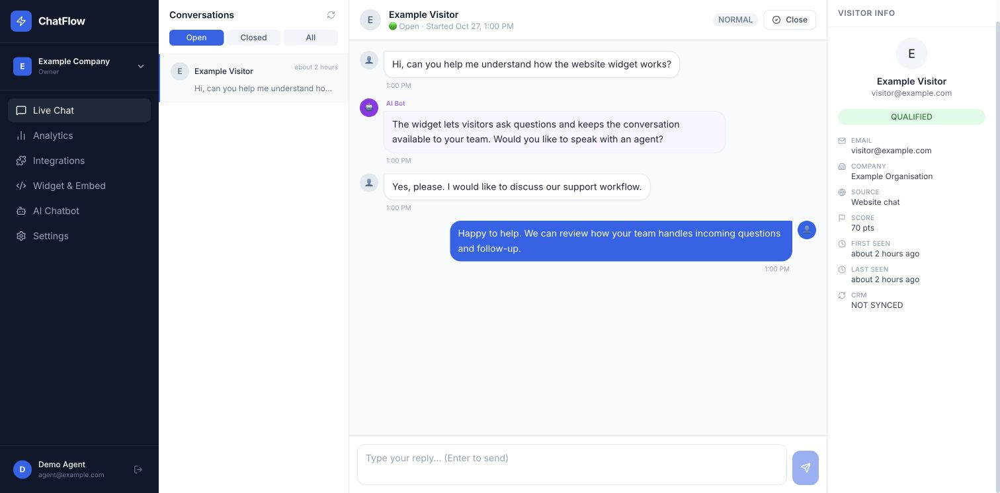
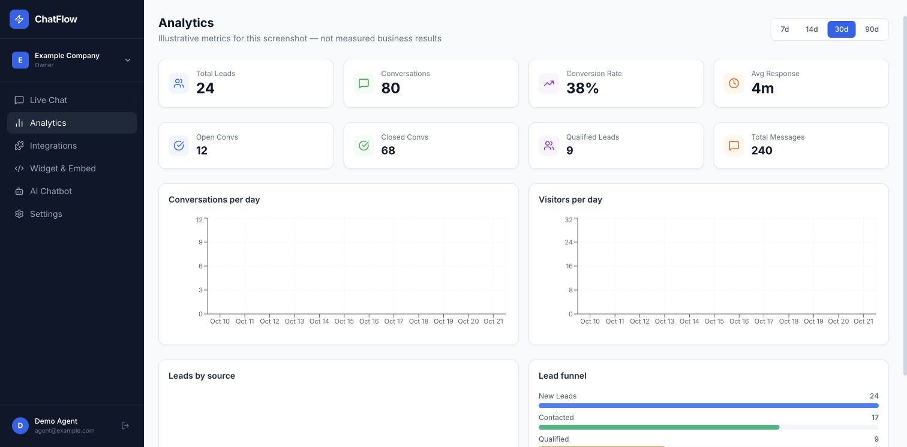
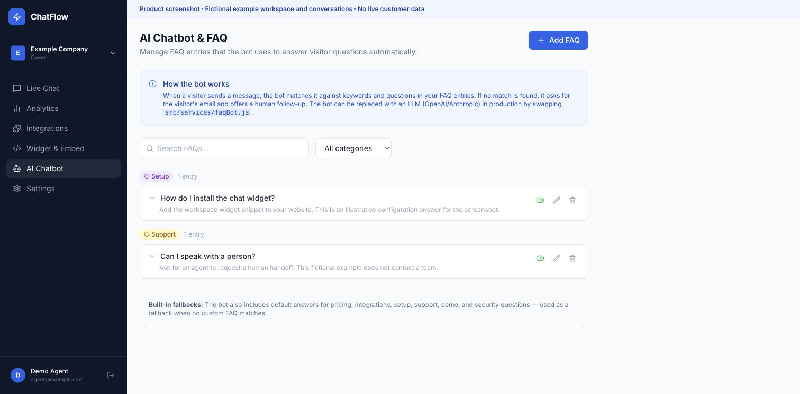

# ChatFlow — Chat, Lead Capture & Team Inbox

**Product screenshots below show the actual application's interface.** This project is presented as a visual case study; no public app demo is linked.

Built by **Ismail Bellakhel** to explore how website questions become answers, human conversations and follow-up opportunities.

## Screenshots

These screenshots were captured from the actual React dashboard running locally with fictional conversation and analytics fixtures. Names, contact details and metrics are illustrative, not customer records or measured business results.

### Team inbox and human handoff

An agent can review a visitor conversation alongside its lead context. FAQ answers can guide the visitor, with a human handoff for questions needing personal follow-up.

### Conversation and lead analytics

The dashboard presents conversation activity, leads, response-time metrics and source/funnel views. The values in this screenshot are synthetic fixtures used to demonstrate the layout.

### FAQ management

Workspace FAQ entries provide editable questions, answers, categories and matching keywords. The implemented bot uses deterministic matching and a human fallback; it is not a connected generative model.

## Project scope

The private prototype combines a website widget, conversation inbox, lead context, FAQ configuration and analytics. CRM connection screens are prototypes; live OAuth and CRM sync are not implemented. Production use needs further validation.

The full application source, backend, database, credentials and private Git history remain outside this showcase. A small selected routing example is retained in [sample.mjs](sample.mjs) for optional technical review, with synthetic checks runnable using `npm test`.

No conversion lift, service guarantee, compliance certification or customer adoption is claimed.
